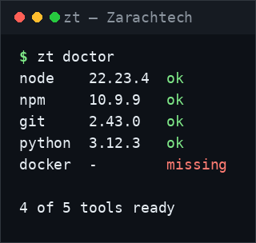
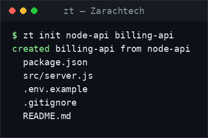
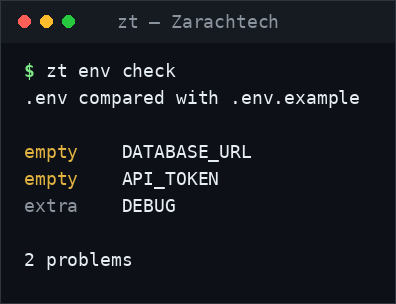
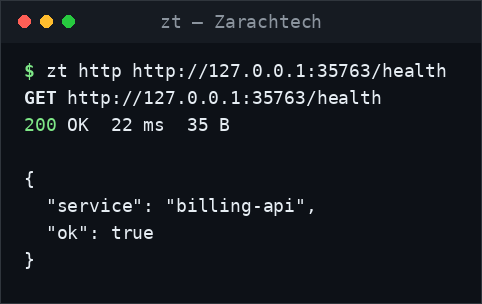
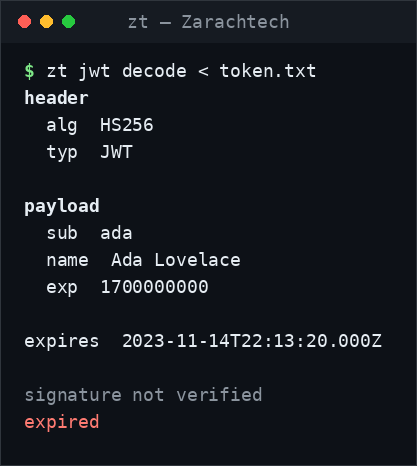
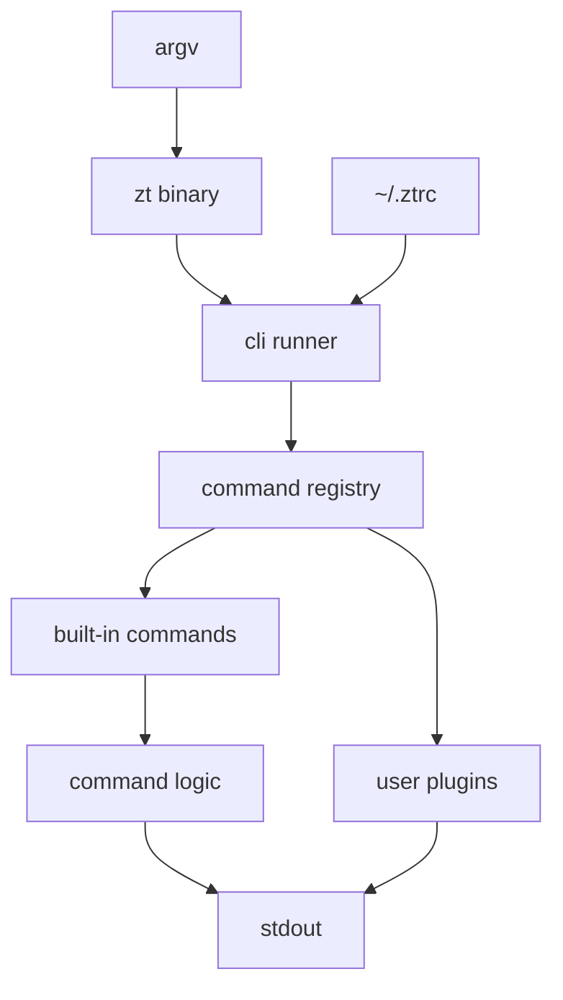

# zt

Everyday developer tasks in one command: scaffold a project, check an env file, write a conventional commit, and inspect ports, HTTP, JSON, JWTs, and UUIDs.

[](https://github.com/maikama8/dev-cli-toolkit/actions/workflows/ci.yml)
[](LICENSE)
[](https://nodejs.org/)
[](https://www.typescriptlang.org/)



`zt` is the developer CLI from Zarachtech. The binary is `zt`. The npm package is `@zarachtech/zt`. It needs Node.js 18 or newer and has one runtime dependency, [Commander](https://github.com/tj/commander.js).

## Features

- `zt init` writes a `node-api`, `react-app`, or `python-api` project. The name comes from the directory.
- `zt env check` compares `.env` with `.env.example` and lists missing keys, blank values, and extra keys.
- `zt git commit` builds a [Conventional Commits](https://www.conventionalcommits.org/) message from flags or from a prompt.
- `zt git cleanup` deletes local branches already merged into the base branch. It uses `git branch -d`. It does not touch remotes.
- `zt git changelog` turns those commits into markdown.
- `zt port who` and `zt port kill` look up a TCP listener. Linux tries `ss` then `lsof`, macOS uses `lsof`, Windows uses `netstat`.
- `zt http` prints the status, the timing, the size, and a pretty JSON body.
- `zt json`, `zt base64`, `zt jwt decode`, and `zt uuid` cover the encodings that show up in logs.
- `zt doctor` reports the versions of node, npm, git, python, and docker.
- Commands are plugins. A file named in `~/.ztrc` can add another one.
- `--json` prints a single document. In a terminal the same result is colored. `NO_COLOR` is honored unless you pass `--color`.

## Quick start

```bash
npm install -g @zarachtech/zt
zt --help
```

From a checkout:

```bash
git clone https://github.com/maikama8/dev-cli-toolkit.git
cd dev-cli-toolkit
npm ci
npm test
npm run build
node dist/bin.js --help
```

`npm link` puts `zt` on your `PATH`. `make test`, `make lint`, `make typecheck`, and `make build` wrap the npm scripts. CI does not use `make`, because the Windows runner does not have it.

## Configuration

`zt` reads `~/.ztrc`, or the file in `ZT_CONFIG`, or `--config <path>`. The file is JSON. A missing default file is not an error. A missing `--config` path is. Unknown keys are ignored so the file can grow.

Relative plugin paths are resolved from the directory that contains the config file.

[`examples/ztrc.json`](examples/ztrc.json) is the shape:

```json
{
  "color": true,
  "git": {
    "baseBranch": "main",
    "protectedBranches": ["main", "master", "develop"]
  },
  "http": {
    "timeoutMs": 10000
  },
  "doctor": {
    "minVersions": {
      "node": "18.0.0",
      "npm": "9.0.0",
      "git": "2.30.0"
    }
  },
  "plugins": []
}
```

| Field | Default | Purpose |
| --- | --- | --- |
| `color` | unset | `true` or `false` overrides the terminal. `--color` and `--no-color` still win |
| `git.baseBranch` | `main` | Base branch for `zt git cleanup` |
| `git.protectedBranches` | `main`, `master`, `develop` | Never deleted by cleanup, even when merged |
| `http.timeoutMs` | `10000` | Request timeout. `--timeout` overrides it |
| `doctor.minVersions` | node 18, npm 9, git 2.30 | Below this, doctor reports `outdated`. A map in the file replaces these defaults |
| `plugins` | empty | Absolute or relative paths of plugin modules |

`NO_COLOR` set to any non-empty value turns color off. `--color` turns it back on. `--json` never prints color. Color is also off when stdout is not a terminal, unless config or `--color` forces it on.

`ZT_DEBUG=1` prints an error stack on stderr. It does nothing when `--json` is set.

## Command reference

Global flags, on the root command and on every leaf: `--json`, `--color`, `--no-color`, `--config <path>`, `-h`, `--help`, `-v`, `--version`.

`zt --json env check` and `zt env check --json` both print JSON.

| Command | Purpose |
| --- | --- |
| `zt init` | Scaffold a node-api, react-app, or python-api project |
| `zt env check` | Compare `.env` with `.env.example` |
| `zt git commit` | Write a conventional commit |
| `zt git cleanup` | Delete local branches already merged into the base |
| `zt git changelog` | Render those commits as markdown |
| `zt port who` | Show the process listening on a TCP port |
| `zt port kill` | Stop that process |
| `zt http` | Print status, timing, size, and a JSON body |
| `zt json` | Format, minify, or pick a value out of a document |
| `zt base64` | Encode or decode base64 and base64url |
| `zt jwt decode` | Read a JWT without checking the signature |
| `zt uuid` | Generate or validate a UUID |
| `zt doctor` | Report node, npm, git, python, and docker |

### `zt init [template] [directory]`



Templates:

| Name | What it writes |
| --- | --- |
| `node-api` | A JSON server on `node:http`. `npm start` listens on `127.0.0.1` and `PORT` (3000). |
| `react-app` | React 18 and Vite. `npm install` then `npm run dev`. |
| `python-api` | A JSON server on the Python standard library. `python app.py` listens on `PORT` (8000). |

```text
$ zt init node-api billing-api
created billing-api from node-api
  package.json
  src/server.js
  .env.example
  .gitignore
  README.md
```

The project name is the directory name, lowercased, with anything outside `[a-z0-9]` turned into a hyphen. `Billing API` becomes `billing-api`. `{{name}}` in the template is replaced with that name. An existing file is left alone unless you pass `--force`. `--list` prints the three names and does not write anything.

The Node and Python servers do not load a `.env` file. They read the process environment. Copy the example and export the variables.

### `zt env check`



```text
$ zt env check
.env compared with .env.example

empty    DATABASE_URL
empty    API_TOKEN
extra    DEBUG

2 problems
```

Exit code 1, because a blank value is still unset for most programs. `PORT` was present and non-empty, so it is not listed. `DEBUG` is extra: it is reported and does not fail the command. `--strict` fails on extra keys too. In the picture above, `DATABASE_URL` and `API_TOKEN` were present but blank.

Flags: `--env <path>` (default `.env`), `--example <path>` (default `.env.example`).

The parser accepts `export KEY=value`, single or double quotes, blank lines, `#` comments, and an inline ` #` comment on an unquoted value. It does not expand `$OTHER` and it does not process backslash escapes. A line that is not an assignment is an error, with the line number.

```json
{
  "ok": false,
  "error": { "code": "ENV_DRIFT", "message": "2 problems in .env" },
  "data": {
    "missing": [],
    "empty": ["DATABASE_URL", "API_TOKEN"],
    "extra": ["DEBUG"],
    "ok": ["PORT"],
    "problems": 2
  }
}
```

### `zt git commit`

Stage the files first, or pass `--all` (the same as `git commit -a`).

```text
$ zt git commit --type feat --scope api --subject "add health route" --body "GET /health returns ok"
committed 9307db1

feat(api): add health route

GET /health returns ok
```

Types: `feat`, `fix`, `docs`, `style`, `refactor`, `perf`, `test`, `build`, `ci`, `chore`, `revert`. A scope, when you pass one, is limited to letters, numbers, `.`, `_`, `/`, and `-`.

`--breaking "drop the v1 field"` adds the `!` and a `BREAKING CHANGE:` footer:

```text
feat!: change the payload

BREAKING CHANGE: drop the v1 field
```

In a terminal, a missing type or subject is prompted (`type`, `scope`, `subject`, `body`, `breaking change`). Without a terminal, the command exits 1 and tells you to pass `--subject`. `--dry-run` prints the message and does not run `git commit`. It does not need a repository.

### `zt git cleanup`

Lists local branches merged into the base (`--base`, default from config, otherwise `main`) and deletes them with `git branch -d`.

```text
$ zt git cleanup --dry-run
would delete 1 merged branch
  feature/login
```

The current branch, and `main`, `master`, `develop`, and `git.protectedBranches`, are kept. A branch that is not merged is kept. Remote branches are kept. The delete is `git branch -d`, so git itself will refuse a branch that is not actually merged.

`--dry-run` only prints. A real delete needs `--yes`, or a `y` answer when stdout is a terminal. Outside a terminal, omitting both exits 1 with `CLEANUP_CONFIRM`.

### `zt git changelog`

Reads `git log` and groups conventional commits.

```text
$ zt git changelog
# Changelog

## Unreleased

### Features

- **api:** add health route (`9307db1`)

### Chores

- initial (`018130c`)
```

A subject git does not recognize as a conventional commit goes under `Other`. A `!` in the header, or a `BREAKING CHANGE:` footer, is also listed under `Breaking changes`.

The default prints markdown, so `zt git changelog > CHANGELOG.md` works. `--from <rev>` and `--to <rev>` become `from..to` (`from..HEAD` when `--to` is omitted). `--out CHANGELOG.md` writes the file and refuses to replace an existing one unless you pass `--force`. `--json` wraps the markdown instead of printing it raw.

### `zt port who <port>` and `zt port kill <port>`

```text
$ zt port who 45199
port 45199
  node  pid 3268  ubuntu  127.0.0.1:45199
```

That pid was a Node server started for the check. Nothing listening prints `nothing is listening on <port>` and exits 0.

`zt port kill` sends `SIGTERM` on macOS and Linux, and runs `taskkill /PID <pid> /F` on Windows. It will not signal pid 1 or its own pid. Without `--yes`, a terminal asks first and anything else exits 1 with `KILL_CONFIRM` before a signal is sent.

Only TCP listeners are considered. A UDP socket is left alone.

### `zt http [method] <url>`



```text
$ zt http http://127.0.0.1:35763/health
GET http://127.0.0.1:35763/health
200 OK  22 ms  35 B

{
  "service": "billing-api",
  "ok": true
}
```

The picture is a request to a local server this repo started for the shot. The 22 ms is the time `fetch` took.

One argument is the URL. A body (`-d` / `--data`) with one argument uses `POST`. Two arguments are the method and the URL: `GET`, `POST`, `PUT`, `PATCH`, `DELETE`, or `HEAD`.

`-H` / `--header` repeats (`Name: value`). `-t` / `--timeout` is milliseconds. `-i` / `--include` prints response headers. `-f` / `--fail` exits 1 when the status is 400 or higher; without it, a 404 is still a successful command, because the request completed. Bodies over 1 MB are truncated. Only `http:` and `https:` URLs are sent.

### `zt json`

```text
$ zt json get user.name doc.json
Ada

$ zt json format doc.json
{
  "user": {
    "name": "Ada"
  },
  "items": [
    {
      "id": 7
    }
  ]
}
```

`format` and `minify` read a file or stdin. `get <path> [file]` walks dots. A numeric segment indexes an array: `items.0.id`. A missing path exits 1 with `PATH_NOT_FOUND`. A string value is printed raw so it can be piped; objects and arrays are pretty-printed. `--json` always wraps the value.

### `zt base64`

```text
$ zt base64 encode "hello"
aGVsbG8=

$ zt base64 decode --url aGVsbG8
hello
```

`--url` is base64url, without padding on encode. The alphabet is checked. Characters outside it exit 1 with `BASE64_INVALID`. Omit the argument to read stdin.

### `zt jwt decode [token]`



```text
$ zt jwt decode < token.txt
header
  alg  HS256
  typ  JWT

payload
  sub  ada
  name  Ada Lovelace
  exp  1700000000

expires  2023-11-14T22:13:20.000Z

signature not verified
expired
```

The token is three base64url segments. The header and payload are decoded and printed. The signature is not verified, not checked against a key, and not printed back. `exp` in the past prints `expired`. `nbf` in the future prints `not valid yet`. The token in the picture expires at `2023-11-14T22:13:20.000Z`. Do not treat the payload as authenticated.

### `zt uuid`

`zt uuid` and `zt uuid generate` print one UUID v4 from `crypto.randomUUID()`. `--count` / `-n` prints up to 100, one per line.

```text
$ zt uuid validate 00000000-0000-0000-0000-000000000000
valid nil uuid
```

Anything that is not a UUID exits 1 with `UUID_INVALID`. The nil UUID is valid and has no version. Any other accepted UUID reports the version nibble.

### `zt doctor`

```text
$ zt doctor
node    22.23.4  ok
npm     10.9.9   ok
git     2.43.0   ok
python  3.12.3   ok
docker  -        missing

4 of 5 tools ready
```

Python tries `python3`, then `python`. A tool that is older than `doctor.minVersions` is `outdated` and the minimum is printed next to it. The command exits 0 when something is missing. `--strict` exits 1 unless every row is `ok`.

## Architecture



The runner loads config, builds a context, and hands the root command to every plugin. A plugin calls `register` and adds a Commander command. The work of each command lives in a function that does not print: parsing an env file, choosing merged branches, reading `ss` output, decoding a JWT. The command prints that result once. Tests call the functions directly, and a smaller set drives `run()` with a temp directory, a stand-in for `execFile`, or a local HTTP server.

`--json` changes the printer, not the function. A success is `{ "ok": true, "data": ... }`. A failure is `{ "ok": false, "error": { "code", "message" }, "data": ... }` and a non-zero exit. The document goes to stdout either way, so a script can pipe it.

## Project structure

```text
dev-cli-toolkit/
├── src/
│   ├── bin.ts                 # zt process entry
│   ├── cli.ts                 # config, registry, run()
│   ├── commands/              # one plugin per command group
│   └── lib/                   # parsers and actions, including the three templates
├── test/                      # vitest, temp dirs, stand-in processes
├── examples/ztrc.json
├── examples/plugin.mjs
├── docs/images/               # screenshots from a live zt run
├── scripts/termshot.py        # redraws those screenshots from a pty
└── .github/workflows/ci.yml   # Linux, macOS, and Windows
```

The template strings live in `src/lib/templates.ts`, so the published package does not need to copy a directory of fixtures. Changes are recorded in [CHANGELOG.md](CHANGELOG.md).

## Testing

```bash
npm run lint
npm run typecheck
npm test
npm run build
node dist/bin.js --version
```

GitHub Actions (`.github/workflows/ci.yml`) runs that list on `ubuntu-latest`, `macos-latest`, and `windows-latest` for Node.js 22, on pushes to `main` and on pull requests.

The suite covers env parsing (quotes, `export`, inline comments, a BOM), the three scaffolds including `node --check` on the generated server, conventional messages and the prompt, changelog grouping and revision ranges, a real git repository for commit / cleanup / changelog, cleanup confirmation, `lsof` / `ss` / Windows `netstat` text, a refusal to kill pid 1 or the current process, kill confirmation, HTTP against a local server, JSON paths, base64 and base64url, JWT expiry without a signature check, UUID v4, doctor version comparison, config shape, the plugin registry, plugin load failures, and `--json` / `--help` / `--version`.

`zt port who` is also pointed at a server the test itself is listening on. `zt port kill` is not: the listener and the test are the same pid, and the command refuses to signal itself. Kill is tested with a stand-in that records the pid.

## Extending with plugins

A plugin is a module with `name`, `description`, and `register(program, ctx)`. A default export is the usual shape. Named exports work too. [`examples/plugin.mjs`](examples/plugin.mjs):

```js
export default {
  name: "hello",
  description: "Say hello from a zt plugin",
  register(program, ctx) {
    program
      .command("hello")
      .description("Say hello from a zt plugin")
      .argument("[name]", "who to greet", "world")
      .option("--json", "print machine-readable JSON")
      .action((name) => {
        ctx.output.ok({ greeting: `Hello, ${name}` }, `Hello, ${name}`);
      });
  },
};
```

Point `plugins` at that file. A relative path is resolved from the directory that contains the config file, so an absolute path is the one to put in `~/.ztrc`:

```json
{ "plugins": ["/absolute/path/to/examples/plugin.mjs"] }
```

```text
$ zt hello Ada
Hello, Ada
```

`ctx.output.ok(data, human)` prints the sentence, or `{ "ok": true, "data": ... }` when `--json` is set. `ctx.output.fail(code, message)` prints and exits 1. Built-in names are reserved; a plugin that reuses `init` or `doctor` fails at startup with `PLUGIN_DUP`.

TypeScript callers can import the types from the package:

```ts
import type { CommandPlugin } from "@zarachtech/zt";
```

Importing the package does not run the CLI. The binary is `dist/bin.js`.

## Limits

`zt jwt decode` does not verify a signature. `zt port kill` stops a process on your machine, and only after `--yes` or a prompt. `zt git cleanup` deletes local branches that git already considers merged. It does not delete remote branches and it does not force-delete. `zt http` sends the URL you named; it does not add a proxy, a retry storm, or a way to reach a non-HTTP scheme.

## Roadmap

- Shell completions for bash, zsh, and PowerShell.
- `zt plugin add <path>` so a plugin is not a hand-edited JSON path.
- A TypeScript variant of `node-api`, and a Go API template.
- `zt git commit` signing, using the git config you already have.
- A file of HTTP requests, still one response at a time.
- Doctor rows you can ignore without `--strict` flipping the whole command.

## Contributing

Issues and pull requests are welcome. See [CONTRIBUTING.md](CONTRIBUTING.md) for the local checks, and [CODE_OF_CONDUCT.md](CODE_OF_CONDUCT.md) for how to take part. Report a vulnerability through the [security policy](SECURITY.md).

## Author

**Abdulrasheed Oseni** ([@maikama8](https://github.com/maikama8)), Zarachtech.

## License

[MIT](LICENSE) © 2026 Abdulrasheed Oseni.
